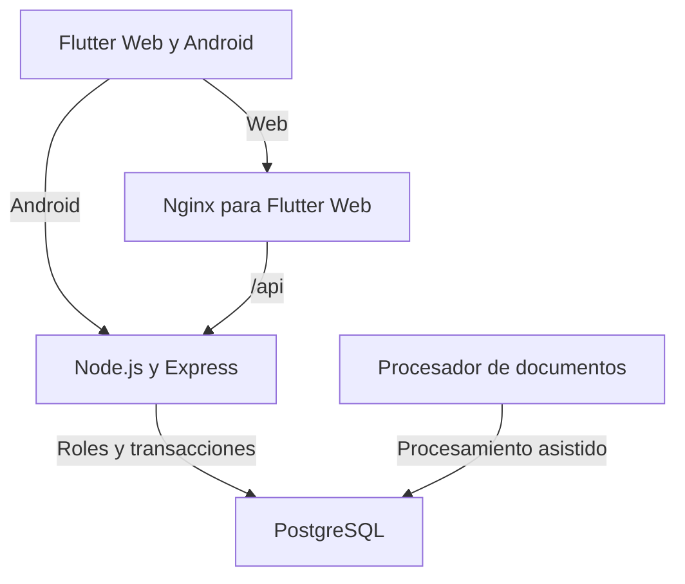
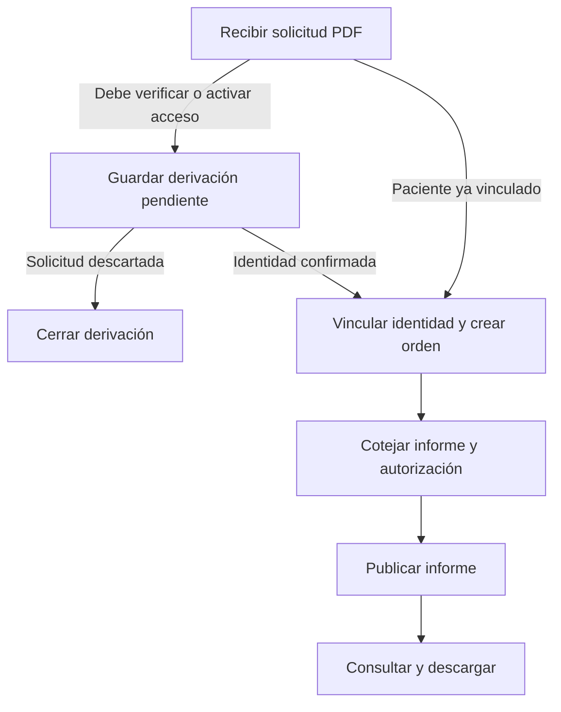

# Vitalia Health · Arquitectura y alcance postanalítico

Vitalia Health es un proyecto de título de Ingeniería en Informática de Duoc UC.
Su flujo comienza con la recepción de una solicitud y termina con la distribución
controlada del informe autorizado. La comprobación del PDF original y de su
autorización externa precede a la publicación.

## Arquitectura

- La API aplica autenticación, roles y pertenencia activa al laboratorio. El
  permiso de revisión habilita al operador para revisar y publicar.
- PostgreSQL conserva asociaciones, órdenes, documentos y eventos de auditoría.
  Las operaciones críticas agrupan sus escrituras en transacciones.
- La consulta de un informe exige que esté publicado, que corresponda al paciente
  autenticado y que su asociación y laboratorio estén activos.
- La extracción asistida propone datos para cotejo humano. El asistente de
  informes responde con orientación educativa. La comparación conserva examen,
  analito, unidad y laboratorio como criterios de compatibilidad.

## Recorrido de roles

| Rol | Responsabilidad | Control comprobable |
| --- | --- | --- |
| Administrador | Crear laboratorios, gestionar invitaciones y operadores, consultar actividad | Selección por laboratorio y auditoría de la cuenta que ejecuta cada acción |
| Operador | Recibir, cotejar, ordenar y preparar documentos | Membresía activa, verificación de identidad y trazabilidad |
| Operador con permiso de revisión | Revisar y publicar informes con autorización externa | Permiso explícito y confirmaciones antes de publicar |
| Paciente | Activar o vincular su acceso y consultar informes publicados | Sesión propia, asociación al laboratorio y restricción al informe del titular |

**El permiso de revisión no constituye un rol independiente.** El administrador entrega la invitación de operador por un canal oficial. El
Camino A del paciente parte de una invitación emitida después de la verificación
de identidad. El Camino B parte de la cuenta autenticada del paciente y usa un
código temporal entregado al operador durante el cotejo de identidad. El sistema
no crea una asociación clínica por coincidencia de datos de contacto.

## Evidencia y operación

La [guía de operación y trazabilidad](OPERACION_SIL_PRINCIPAL.md) documenta el
procedimiento de actualización, el alcance y las comprobaciones por requisito.
El [workflow SIL](../.github/workflows/sil-main-integration.yml) ejecuta las pruebas
Jest y Flutter, el ensayo aislado de PostgreSQL y el recorrido de los tres roles
en Edge. El [recorrido](../backend/test/sil-main-journey.cjs) utiliza datos
ficticios y registra las comprobaciones de cada etapa.
